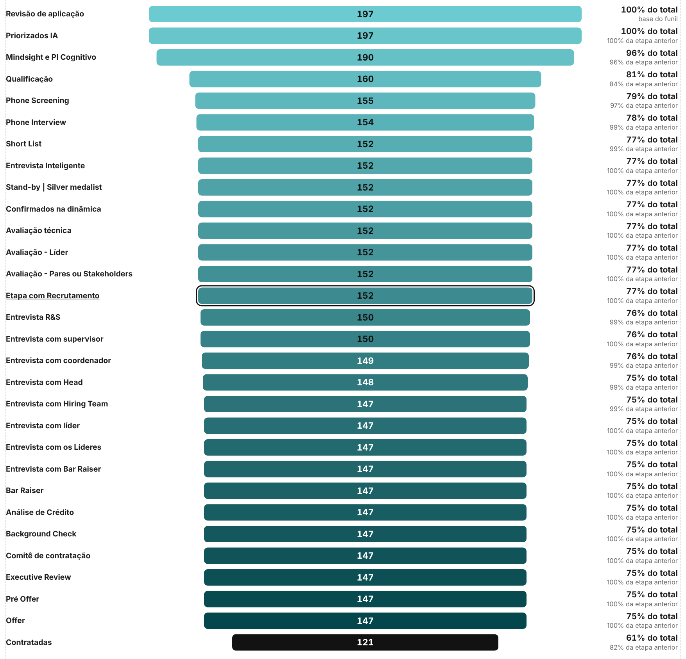

# 02 · Funil no dash de Esteiras

Visual: **XP · Funil** (`dist/XP - Funil 1.2.0.pbiviz`).
Onde entra: o card "Quantas aplicações precisamos para contratar" da página **Resumo** (fundo SVG: x 292, y 576, 1588 × 460).



## 1. Importar
Painel **Visualizações** → `...` → **Importar um visual de um arquivo** → `XP - Funil 1.2.0.pbiviz`.
Atualize também o Card de KPI para a **1.2.1** (nova opção "Cor do texto de contexto", usada nos cards ao lado do funil).

## 2. Campos do visual
| Campo | O que colocar |
|---|---|
| Etapas | Coluna com as etapas, ordenada por "Classificar por coluna" |
| Valor | Medida com a quantidade em cada etapa |
| Grupo (cor e legenda) (opcional) | Coluna de grupo (ex.: `dFunil[grupo]`). Colore por grupo, na ordem em que aparecem, e mostra legenda |
| Base do % (opcional) | Denominador do "% do total". Se vazio, usa a primeira etapa |

Formatação (em português): formato funil (centralizado) ou barras (à esquerda), cor das barras, destaque da última etapa, uma etapa em destaque pelo nome, altura, espaço entre linhas, largura dos nomes, textos dos percentuais.
Clique numa etapa filtra os outros visuais (se houver relação); com muitas etapas o visual ganha rolagem.

## 3. Montagem no Resumo
Layout dentro do card (abaixo do título): dois cards de razão à esquerda e o funil à direita.

| Visual | X | Y | Largura | Altura |
|---|---|---|---|---|
| Card de KPI · Aplicações por contratação | 318 | 660 | 340 | 172 |
| Card de KPI · No recrutador, por contratação | 318 | 844 | 340 | 172 |
| XP · Funil | 698 | 660 | 1156 | 356 |

### XP · Funil
- **Etapas**: `dFunil[passo]` (classificada por `dFunil[ordem_passo]`)
- **Valor**: `Esteira | Funil Aplicações`
- **Base do %**: `Esteira | Candidatos` (ou deixe vazio)
- Formatar → Barras → **Etapa em destaque**: `Chegaram ao recrutador`
- Formatar → Geral → Título e Plano de fundo: desligados

### Cards de razão (XP · Card de KPI)
Medidas de texto novas:
```DAX
Esteira | Texto Aplicações por Contratação =
FORMAT([Esteira | Candidatos], "#,0") & " aplicações para "
    & FORMAT([Esteira | Contratados], "#,0") & " contratações"

Esteira | Texto Recrutador por Contratação =
FORMAT([Esteira | Chegaram ao Recrutador], "#,0") & " chegaram ao recrutador para "
    & FORMAT([Esteira | Contratados], "#,0") & " contratações"
```
Formato das medidas `Esteira | Aplicações por Contratação` e `Esteira | Recrutador por Contratação`: decimal com 1 casa (`0.0`).

| | Aplicações por contratação | No recrutador, por contratação |
|---|---|---|
| Valor do período | Esteira \| Aplicações por Contratação | Esteira \| Recrutador por Contratação |
| Texto de contexto | Esteira \| Texto Aplicações por Contratação | Esteira \| Texto Recrutador por Contratação |
| Período do valor | Esteira \| Período Selecionado | Esteira \| Período Selecionado |
| Geral → Efeitos → Plano de fundo | `#121212`, transparência 0 % | `#E3F1F0`, transparência 0 % |
| Geral → Borda visual → Cantos arredondados | 14 px | 14 px |
| Cabeçalho → Cor do título | `#9FD3D6` | `#04585D` |
| Valor principal → Cor | `#FFFFFF` | `#1F1F1F` |
| Aparência → Cor do texto de contexto | `#D5D5D5` | `#1F1F1F` |
| Períodos → Estilo do selo | Neutro | Destaque |

## 4. Conferência
- A primeira etapa é igual ao card **Aplicações** e a última ao card **Contratados**.
- Nenhuma etapa pode ser maior que a anterior. Se "Contratadas" passar de "Chegaram à Offer", a medida `Esteira | Contratados` está contando pela data de contratação, e não pela data de aplicação: o funil precisa das duas pela mesma data (aplicação).

## Cores por grupo (1.1.0)
Paleta padrão validada para daltonismo e visão normal: Triagem `#00959C`, Avaliações `#6250D6`, Entrevistas `#5E8C1F`, Checagens `#C2477F`, Offer `#2A78D6`; a última etapa fica `#121212`. Vermelho, laranja e amarelo ficam de fora porque são as cores de status (rejeitado, em andamento) nos outros visuais. Ajustável em **Formatar → Cores dos grupos**. Com grupos, a etapa em destaque ganha contorno em vez de outra cor.

## Degradê por etapa (1.2.0, padrão)
**Formatar → Barras → Cores das barras**: *Degradê por etapa* (padrão), *Uma cor por grupo (com legenda)* ou *Cor única*.
No degradê, a primeira etapa usa `#6CCBD0` e a penúltima `#03474C` (ajustáveis); a última etapa continua na cor de destaque final (`#121212`). A interpolação é feita em OKLCH, então os tons do meio não ficam acinzentados. O número dentro da barra alterna entre preto e branco conforme o contraste. Sem legenda; o campo "Grupo" só é usado no modo por grupo.
