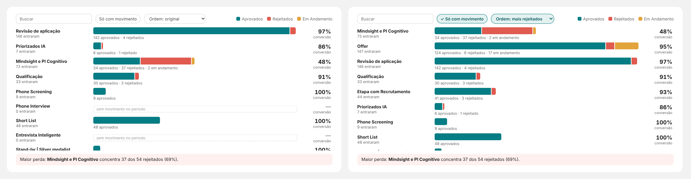

# 03 · Barras com composição — "Onde a esteira perde candidatos"

Visual: **XP · Barras com composição** (`dist/XP - Barras com composicao 1.0.0.pbiviz`).
Onde entra: card "Onde a esteira perde candidatos" da página **Resumo** (fundo SVG: x 292, y 1060, 968 × 540).



## Campos
| Campo | O que colocar |
|---|---|
| Linhas | `dEtapa[stage_name]` — botão direito no campo → **Mostrar itens sem dados** |
| Partes da barra | `Esteira \| Aprovados`, `Esteira \| Rejeitados`, `Esteira \| Em Andamento` (nesta ordem) |
| Total da linha | `Esteira \| Participantes` |
| Indicador à direita | `Esteira \| Conversão Geral %` |
| Texto de destaque | `Esteira \| Texto Maior Perda` |

```DAX
Esteira | Texto Maior Perda =
VAR T =
    CALCULATETABLE(
        ADDCOLUMNS( VALUES( dEtapa[stage_name] ), "@rej", [Esteira | Rejeitados] ),
        ALLSELECTED( dEtapa )
    )
VAR TotalRej = SUMX( T, [@rej] )
VAR Top1 = TOPN( 1, T, [@rej], DESC )
VAR Nome = MAXX( Top1, dEtapa[stage_name] )
VAR Rej = MAXX( Top1, [@rej] )
RETURN
IF(
    TotalRej > 0,
    "Maior perda: **" & Nome & "** concentra " & FORMAT( Rej, "#,0" ) & " dos "
        & FORMAT( TotalRej, "#,0" ) & " rejeitados (" & FORMAT( DIVIDE( Rej, TotalRej ), "0%" ) & ").",
    "Nenhuma rejeição no período."
)
```
`**texto**` vira negrito no visual.

## Posição e formatação
- X **318**, Y **1140**, largura **916**, altura **440**. Geral → Título e Plano de fundo desligados.
- Cores padrão: parte 1 teal `#067D84`, parte 2 vermelho `#E05A4F`, parte 3 âmbar `#E3A33B` (cores de status XP).
- Nomes → Nome da parte 3: `Em andamento`.
- Sem limite de alerta na conversão (ainda não há meta).

## Ferramentas (dentro do visual)
Busca, "Só com movimento" e ordem (original, maior total, mais rejeitados, menor indicador). Abrem no estado padrão a cada abertura do relatório; "Abrir só com movimento" em Formatar → Ferramentas.
