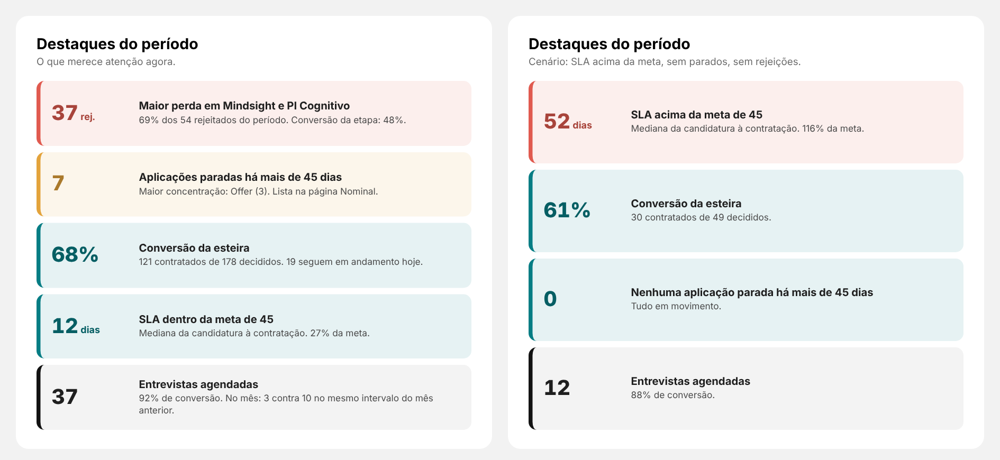

# 04 · Lista de destaques — "Destaques do período"

Visual: **XP · Lista de destaques** (`dist/XP - Lista de destaques 1.0.0.pbiviz`).
Onde entra: card "Destaques do período" da página **Resumo** (fundo SVG: x 1280, y 1060, 600 × 540).



## Como funciona
Cada destaque é **uma medida de texto** no formato:

```
número || título || texto || status
```
- **número**: "68%", "12 dias", "37 rej." — a primeira palavra fica grande, o resto pequeno.
- **status**: `ruim` (vermelho), `atencao` (âmbar), `bom` (teal) ou `info` (preto).
- Título vazio (ou medida em branco) esconde o destaque.
- Com "Mais graves primeiro" ligado (padrão), a ordem é ruim → atenção → bom → info.

## Medidas (pasta `05. Textos`)
```DAX
Esteira | Etapa Maior Perda =
VAR T = ADDCOLUMNS( VALUES( dEtapa[stage_name] ), "@rej", [Esteira | Rejeitados] )
RETURN MAXX( TOPN( 1, FILTER( T, [@rej] > 0 ), [@rej], DESC ), dEtapa[stage_name] )

Esteira | Destaque Maior Perda =
VAR Nome = [Esteira | Etapa Maior Perda]
VAR Rej = CALCULATE( [Esteira | Rejeitados], TREATAS( { Nome }, dEtapa[stage_name] ) )
VAR Total = [Esteira | Rejeitados]
VAR Conv = CALCULATE( [Esteira | Conversão Geral %], TREATAS( { Nome }, dEtapa[stage_name] ) )
RETURN
IF(
    NOT ISBLANK( Nome ),
    FORMAT( Rej, "#,0" ) & " rej. || Maior perda em " & Nome & " || "
        & FORMAT( DIVIDE( Rej, Total ), "0%" ) & " dos " & FORMAT( Total, "#,0" )
        & " rejeitados do período. Conversão da etapa: " & FORMAT( Conv, "0%" ) & ". || ruim"
)

Esteira | Destaque Parados =
VAR N = COALESCE( [Esteira | Ativos Acima de 45 Dias], 0 )
VAR T = ADDCOLUMNS( VALUES( dEtapa[stage_name] ), "@p", [Esteira | Ativos Acima de 45 Dias] )
VAR Top1 = TOPN( 1, FILTER( T, [@p] > 0 ), [@p], DESC )
VAR Etapa = MAXX( Top1, dEtapa[stage_name] )
VAR NEtapa = MAXX( Top1, [@p] )
RETURN
IF(
    N > 0,
    FORMAT( N, "#,0" ) & " || Aplicações paradas há mais de 45 dias || Maior concentração: "
        & Etapa & " (" & FORMAT( NEtapa, "#,0" ) & "). Lista na página Nominal. || atencao",
    "0 || Nenhuma aplicação parada há mais de 45 dias || Todas as aplicações em processo avançaram nos últimos 45 dias. || bom"
)

Esteira | Destaque Conversão =
VAR C = [Esteira | Contratados]
VAR D = C + [Esteira | Rejeitados no Processo]
VAR A = COALESCE( [Esteira | Ativos Agora], 0 )
RETURN
IF(
    D > 0,
    FORMAT( DIVIDE( C, D ), "0%" ) & " || Conversão da esteira || "
        & FORMAT( C, "#,0" ) & " contratados de " & FORMAT( D, "#,0" ) & " aplicações decididas. "
        & FORMAT( A, "#,0" ) & " seguem em andamento hoje. || bom"
)

Esteira | Destaque SLA =
VAR S = [Esteira | SLA da Esteira (Mediana)]
VAR M = [Esteira | Meta SLA]
RETURN
IF(
    NOT ISBLANK( S ),
    FORMAT( S, "0" ) & " dias || "
        & IF( S <= M, "SLA dentro da meta de ", "SLA acima da meta de " ) & FORMAT( M, "0" )
        & " dias || Mediana da candidatura à contratação. " & FORMAT( DIVIDE( S, M ), "0%" )
        & " da meta consumida. || " & IF( S <= M, "bom", "ruim" )
)

Esteira | Destaque Entrevistas =
VAR E = [Esteira | Entrevistas Agendadas]
VAR Cv = [Esteira | Conversão Entrevista %]
VAR Atual = COALESCE( [Esteira | Entrevistas Agendadas (mês atual)], 0 )
VAR Ant = COALESCE( [Esteira | Entrevistas Agendadas (mês anterior)], 0 )
RETURN
IF(
    E > 0,
    FORMAT( E, "#,0" ) & " || Entrevistas agendadas || "
        & IF( NOT ISBLANK( Cv ), FORMAT( Cv, "0%" ) & " de conversão nas concluídas. ", "" )
        & "No mês: " & FORMAT( Atual, "#,0" ) & " contra " & FORMAT( Ant, "#,0" )
        & " no mesmo intervalo do mês anterior. || info"
)
```

## Montagem
- Destaques: as 5 medidas `Esteira | Destaque …` (qualquer ordem).
- Posição: X **1306**, Y **1140**, largura **548**, altura **440**. Geral → Título e Plano de fundo desligados.
