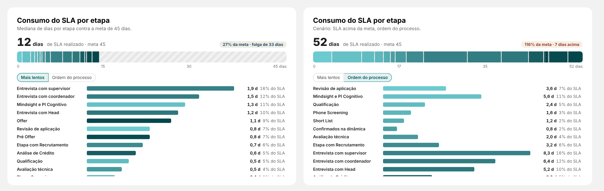

# 05 · Consumo da meta — "Consumo do SLA por etapa"

Visual: **XP · Consumo da meta** (`dist/XP - Consumo da meta 1.1.0.pbiviz`).
Onde entra: card "Consumo do SLA por etapa" da página **Resumo** (fundo SVG: x 292, y 1624, 784 × 480).



## Como funciona
- Número grande = **Total realizado** (SLA mediano). Selo: % da meta e folga (teal) ou excesso (vermelho).
- Régua de 0 até a meta (ou até o total, se passar da meta, com a meta tracejada). Hachurado = folga.
- O total é **repartido** entre os itens pelo **Peso** de cada um: fatia = peso ÷ soma dos pesos × total. Assim as fatias somam exatamente o SLA mediano.
- Lista com rolagem: dias e % do SLA por item; botões "Mais lentos" / "Ordem do processo". Itens sem valor ficam ocultos (Formatar → Lista para mostrar).

## Medidas
```DAX
Esteira | Dias na Etapa (Contratações) =        -- peso: dias médios em cada etapa das contratações do período
VAR Ini = MIN('_dCALENDARIO'[Data])
VAR Fim = MAX('_dCALENDARIO'[Data]) + 1
VAR Contratadas =
    CALCULATETABLE(
        VALUES( '13_ETAPA_RECRUTAMENTO'[application_id] ),
        REMOVEFILTERS( dEtapa ),
        REMOVEFILTERS( '13_ETAPA_RECRUTAMENTO'[stage_name] ),
        KEEPFILTERS( '13_ETAPA_RECRUTAMENTO'[data_contratacao] >= Ini ),
        KEEPFILTERS( '13_ETAPA_RECRUTAMENTO'[data_contratacao] <  Fim )
    )
VAR Dias =
    CALCULATE(
        SUMX(
            SUMMARIZE(
                '13_ETAPA_RECRUTAMENTO',
                '13_ETAPA_RECRUTAMENTO'[application_id],
                '13_ETAPA_RECRUTAMENTO'[stage_name],
                '13_ETAPA_RECRUTAMENTO'[data_entrada_stage],
                '13_ETAPA_RECRUTAMENTO'[days_in_stage]
            ),
            '13_ETAPA_RECRUTAMENTO'[days_in_stage]
        ),
        TREATAS( Contratadas, '13_ETAPA_RECRUTAMENTO'[application_id] )
    )
RETURN DIVIDE( Dias, COUNTROWS( Contratadas ) )

Esteira | SLA (sem etapa) =                       -- total da régua: o mesmo valor em todas as linhas
CALCULATE(
    [Esteira | SLA da Esteira (Mediana)],
    REMOVEFILTERS( dEtapa ),
    REMOVEFILTERS( '13_ETAPA_RECRUTAMENTO'[stage_name] )
)
```
`SUMMARIZE` remove as linhas duplicadas da tabela 13 antes de somar.

## Montagem
| Campo | O que colocar |
|---|---|
| Itens | `dEtapa[stage_name]` |
| Peso de cada item | `Esteira \| Dias na Etapa (Contratações)` |
| Total realizado | `Esteira \| SLA (sem etapa)` |
| Meta | `Esteira \| Meta SLA` |

- Posição: X **318**, Y **1704**, largura **732**, altura **380**. Geral → Título e Plano de fundo desligados.
- `...` → Classificar eixo → `stage_name` → Crescente (a régua e a "Ordem do processo" seguem a `dEtapa`).
- Explicar na página Conceitos: "As fatias repartem a mediana do SLA proporcionalmente ao tempo médio de cada etapa nas contratações do período."

## Mediana | Média (1.1.0)
Preencha **Total alternativo** com `Esteira | SLA Média (sem etapa)` para aparecer o botão **Mediana | Média** ao lado do número. Os nomes dos botões ficam em Formatar → Textos.

```DAX
Esteira | SLA da Esteira (Média) =
VAR Ini = MIN('_dCALENDARIO'[Data])
VAR Fim = MAX('_dCALENDARIO'[Data]) + 1
VAR Contratacoes =
    CALCULATETABLE(
        SUMMARIZE( '13_ETAPA_RECRUTAMENTO', '13_ETAPA_RECRUTAMENTO'[application_id], '13_ETAPA_RECRUTAMENTO'[sla_esteira_dias] ),
        KEEPFILTERS( NOT ISBLANK( '13_ETAPA_RECRUTAMENTO'[sla_esteira_dias] ) ),
        KEEPFILTERS( '13_ETAPA_RECRUTAMENTO'[data_contratacao] >= Ini ),
        KEEPFILTERS( '13_ETAPA_RECRUTAMENTO'[data_contratacao] <  Fim )
    )
RETURN AVERAGEX( Contratacoes, '13_ETAPA_RECRUTAMENTO'[sla_esteira_dias] )

Esteira | SLA Média (sem etapa) =
CALCULATE(
    [Esteira | SLA da Esteira (Média)],
    REMOVEFILTERS( dEtapa ),
    REMOVEFILTERS( '13_ETAPA_RECRUTAMENTO'[stage_name] )
)
```
