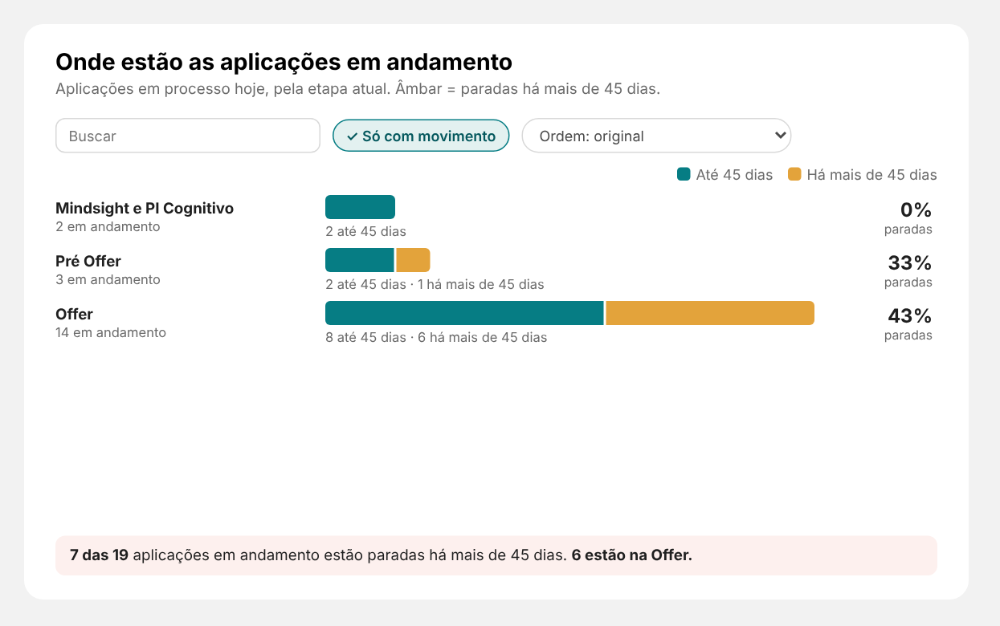

# 06 · "Onde estão as aplicações em andamento" (XP · Barras com composição)

Reaproveita o visual **XP · Barras com composição** (doc 03). Card do **Resumo** embaixo à direita (fundo SVG: x 1096, y 1624, 784 × 480).



## Medidas (pasta `01. Volume`)
```DAX
Esteira | Ativos Até 45 Dias =
COALESCE( [Esteira | Ativos Agora], 0 ) - COALESCE( [Esteira | Ativos Acima de 45 Dias], 0 )

Esteira | % Parados =
DIVIDE( [Esteira | Ativos Acima de 45 Dias], [Esteira | Ativos Agora] )

Esteira | Texto Parados =
VAR N = CALCULATE( [Esteira | Ativos Agora], ALLSELECTED( dEtapa ) )
VAR P = COALESCE( CALCULATE( [Esteira | Ativos Acima de 45 Dias], ALLSELECTED( dEtapa ) ), 0 )
VAR T =
    CALCULATETABLE(
        ADDCOLUMNS( VALUES( dEtapa[stage_name] ), "@p", [Esteira | Ativos Acima de 45 Dias] ),
        ALLSELECTED( dEtapa )
    )
VAR Top1 = TOPN( 1, FILTER( T, [@p] > 0 ), [@p], DESC )
VAR Etapa = MAXX( Top1, dEtapa[stage_name] )
VAR NE = MAXX( Top1, [@p] )
RETURN
IF(
    P > 0,
    "**" & FORMAT( P, "#,0" ) & " das " & FORMAT( N, "#,0" ) & "** aplicações em andamento estão paradas há mais de 45 dias. **"
        & FORMAT( NE, "#,0" ) & " estão em " & Etapa & ".**",
    "Nenhuma aplicação parada há mais de 45 dias."
)
```

## Campos
| Campo | Medida |
|---|---|
| Linhas | `dEtapa[stage_name]` (Mostrar itens sem dados) |
| Partes da barra | `Esteira \| Ativos Até 45 Dias`, `Esteira \| Ativos Acima de 45 Dias` |
| Total da linha | `Esteira \| Ativos Agora` |
| Indicador à direita | `Esteira \| % Parados` |
| Texto de destaque | `Esteira \| Texto Parados` |

## Formatação
- Barras → Cor da parte 2: `#E3A33B`. Faixa de destaque → Cor de fundo: `#FDF6E9`.
- Nomes → Texto após o total: `em andamento`; Nome da parte 1: `Até 45 dias`; Nome da parte 2: `Há mais de 45 dias`.
- Indicador à direita → Texto: `paradas`.
- Posição: X **1122**, Y **1704**, largura **732**, altura **380**. Título e plano de fundo desligados.
