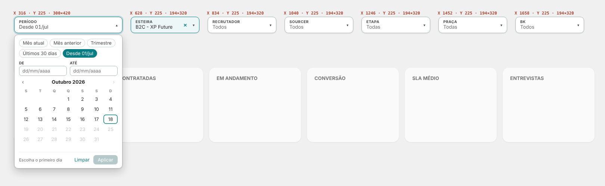
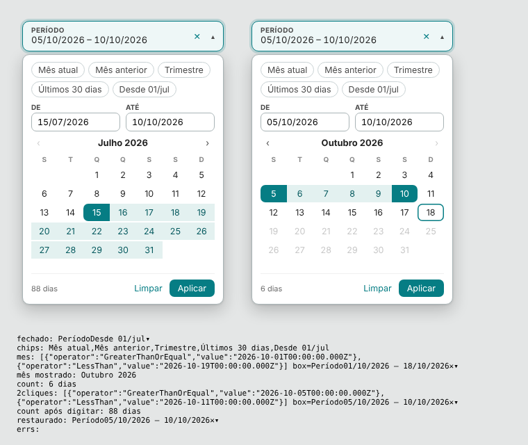
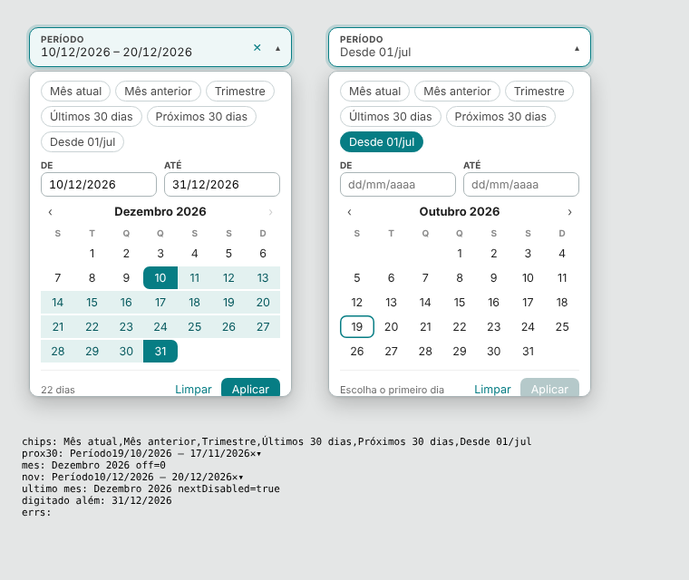

# 07 · Barra de filtros

Visuais: **XP · Período** (`dist/XP - Periodo 2.1.0.pbiviz`) e **XP · Segmentação** (`dist/XP - Segmentacao 2.2.0.pbiviz`).

## Passo a passo
1. Apague os botões "Resumo - Esteiras / Report - Esteiras / Aprovados - Esteiras" e as segmentações nativas (antes, anote o campo de cada uma).
2. Importe os dois .pbiviz (Visualizações → … → Importar de um arquivo).
3. Crie cada visual, preencha os campos e posicione com Formatar → Geral → Propriedades (X, Y, largura, altura) conforme a tabela.
4. Em cada um: Formatar → Geral → desligue **Título** e **Plano de fundo**. Depois Organizar → **Trazer para frente**.
5. Exibição → Sincronizar segmentações: marque Resumo, Report e Nominal para cada filtro (ou copie e cole os visuais nas outras páginas e aceite "Sincronizar").

## Posições (página 1900 de largura)
| Visual | X | Y | Largura | Altura |
|---|---|---|---|---|
| Período | 316 | 225 | 300 | 420 |
| Esteira | 628 | 225 | 194 | 320 |
| Recrutador | 834 | 225 | 194 | 320 |
| Sourcer | 1040 | 225 | 194 | 320 |
| Etapa | 1246 | 225 | 194 | 320 |
| Praça | 1452 | 225 | 194 | 320 |
| BK | 1658 | 225 | 194 | 320 |

A caixa ocupa os primeiros 44 px; o resto da altura é o espaço da lista/calendário aberto. Fechado, esse espaço é transparente, mas cobre o topo dos KPIs (que começam em y = 362): passe o mouse um pouco mais abaixo para ver a dica dos cards.

## Campos
| Visual | Campo | Contagem / Referência | Formatar |
|---|---|---|---|
| Período | Data: `_dCALENDARIO[Data]` (a coluna, **não** a "Hierarquia de datas") | Data de referência: deixe vazio (usa hoje) | Caixa → Título "Período" |
| Esteira | mesma coluna da nativa | `Esteira \| Candidatos` | Cabeçalho → Título "Esteira", Texto sem seleção "Todos" |
| Recrutador | mesma coluna da nativa | `Esteira \| Candidatos` | "Recrutador" / "Todos" |
| Sourcer | mesma coluna da nativa | `Esteira \| Candidatos` | "Sourcer" / "Todos" |
| Etapa | mesma coluna da nativa | `Esteira \| Participantes` | "Etapa" / "Todas" |
| Praça | mesma coluna da nativa | `Esteira \| Candidatos` | "Praça" / "Todas" |
| BK | mesma coluna da nativa | `Esteira \| Candidatos` | "BK" / "Todos" |

Segmentações: Comportamento → Formato "Lista suspensa", Altura da caixa 44.

## XP · Período 2.1: datas futuras

- O calendário vai até a **última data da coluna** (ex.: 31/12 da `_dCALENDARIO`), não só até hoje, para filtrar agendamentos futuros. Formatar → Calendário → "Permitir datas futuras" (ligado por padrão; desligado, o limite volta a ser a referência).
- A Data de referência agora só define o "hoje" dos atalhos e o dia marcado; não limita mais o calendário.
- Novo atalho "Próximos 30 dias" (Formatar → Atalhos, desligado por padrão). Ligado, os atalhos ocupam 3 linhas: use altura 450.

## XP · Período 2.0
- Caixa: "PERÍODO" + intervalo escolhido (sem filtro: "Desde 01/jul", ou o texto de Caixa → Texto sem filtro), ✕ limpa, seta abre.
- Calendário: atalhos (Mês atual, Mês anterior, Trimestre, Últimos 30 dias, Desde o início; "Ano atual" pode ser ligado em Atalhos), campos De/Até digitáveis (dd/mm/aaaa), calendário de um mês com ‹ ›.
- Intervalo: clique no primeiro dia e no último (se o segundo vier antes, inverte). Mesmo dia duas vezes = um dia só. Rodapé mostra quantos dias; Aplicar confirma, Limpar remove.
- Atalhos aplicam na hora. Os atalhos e o dia marcado no calendário usam a Data de referência (sem ela: a última data com dados, limitada a hoje).
- Filtro: data ≥ início e < fim + 1 dia. Fecha com Esc, clique fora ou trocando de visual.

## XP · Segmentação 2.2
- Busca sem acento com destaque, "Selecionar todos (n)" / "Selecionar os n encontrados", Limpar, vários com clique, contagem por item, itens sem dados em cinza no fim, teclado (setas, espaço, Enter).
- Aplica a cada clique. Borda `#A9B4B6` e sombra; cores em Formatar → Cores.
- Outros formatos (Comportamento → Formato): "Janela" (Dialog API) e "Lista sempre aberta".
