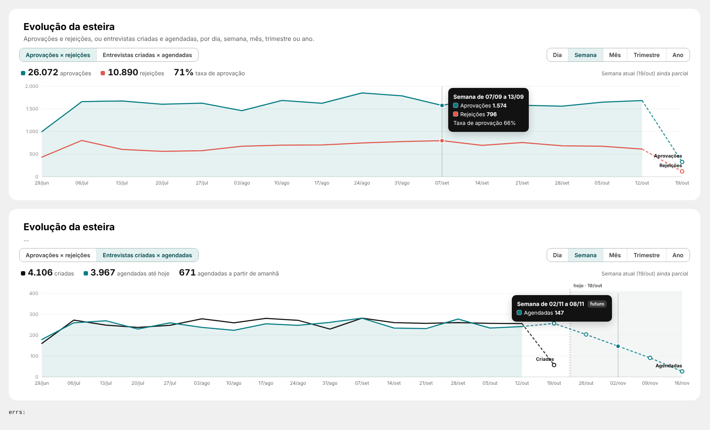

# 08 · Evolução da esteira (página Report)

Visual: **XP · Evolução** (`dist/XP - Evolucao 1.0.0.pbiviz`).

## Posição (fundo `BG - Esteiras_Report.svg`)
| X | Y | Largura | Altura |
|---|---|---|---|
| 316 | 446 | 1540 | 340 |

Formatar → Geral: desligar Título e Plano de fundo.

## Campos
| Campo do visual | O que colocar |
|---|---|
| Data | `_dCALENDARIO[Data]` (a coluna, não a hierarquia) |
| Série 1: primeira linha | `Esteira \| Aprovados por Data` |
| Série 1: segunda linha | `Esteira \| Rejeitados por Data` |
| Série 2: primeira linha | `Esteira \| Entrevistas Criadas` |
| Série 2: segunda linha | `Esteira \| Entrevistas Agendadas` |

As medidas são calculadas por dia e o visual soma os dias em semana, mês, trimestre e ano. Uma aplicação aprovada em duas etapas em dias diferentes conta nas duas datas (são aprovações, não aplicações únicas).

## Como funciona
- Botões de série e de granularidade (Dia, Semana, Mês, Trimestre, Ano). Semana começa na segunda.
- Linha cheia nos períodos fechados; o período atual (parcial) e as datas futuras ficam tracejados, com ponto vazado.
- Linha sem valores no futuro (aprovações, criadas) para no período atual. Linha com valores no futuro (agendadas) segue tracejada, com a área "hoje" sombreada.
- Totais em cima: soma até hoje; para linhas com datas futuras, também o total "a partir de amanhã". Série 1 mostra a taxa = primeira ÷ (primeira + segunda).
- Dica ao passar o mouse com o período, os valores e a taxa.
- Para ver agendadas futuras, o Período precisa incluir datas futuras (ex.: "Desde 01/jul" ou um intervalo até o fim do mês).

## Formatar
- Textos: nome dos botões, nome de cada linha, texto da taxa e das datas futuras.
- Comportamento: granularidade e série ao abrir, mostrar taxa, marcar "hoje".
- Cores: uma por linha (padrão teal/coral na série 1, preto/teal na série 2).
- Área: sob qual linha de cada série fica a área clara.
