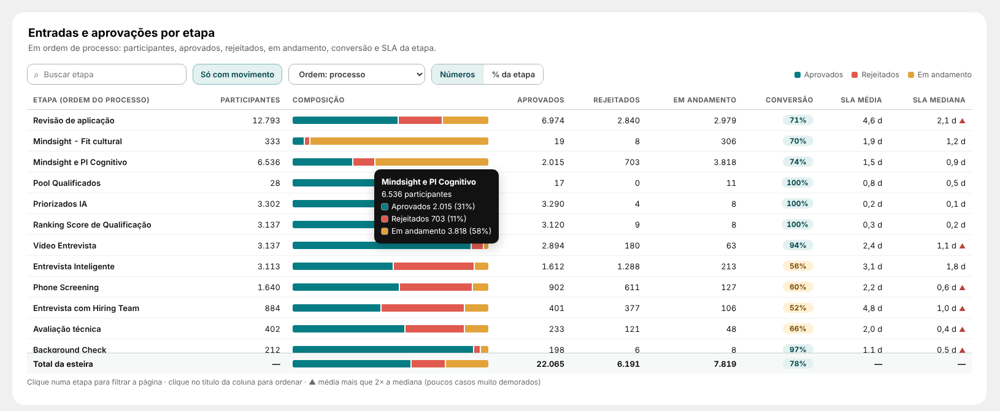

# 09 · Entradas e aprovações por etapa (página Report)

Visual: **XP · Tabela por etapa** (`dist/XP - Tabela por etapa 1.1.0.pbiviz`).

## Posição (fundo `BG - Esteiras_Report.svg`)
| X | Y | Largura | Altura |
|---|---|---|---|
| 316 | 910 | 1540 | 540 |

Formatar → Geral: desligar Título e Plano de fundo.

## Campos
| Campo do visual | O que colocar |
|---|---|
| Etapa | `dEtapa[stage_name]` (a mesma das barras "Onde a esteira perde" do Resumo). **Não** use `dFunil[passo]`: a dFunil não tem relação com a tabela 13 e repete o total em todas as linhas. |
| Participantes | `Esteira \| Participantes` |
| Aprovados | `Esteira \| Aprovados` |
| Rejeitados | `Esteira \| Rejeitados` |
| Em andamento | `Esteira \| Em Andamento` |
| SLA média (dias) | `Esteira \| Dias na Etapa (Média)` |
| SLA mediana (dias) | `Esteira \| Dias na Etapa (Mediana)` |

Conversão é calculada no visual: aprovados ÷ (aprovados + rejeitados), igual ao Resumo.

## Como funciona
- Busca sem acento com destaque; "Só com movimento" esconde etapas zeradas (ligado ao abrir).
- Ordem: lista (processo, mais participantes, menor/maior conversão, mais rejeitados, mais em andamento, maior SLA média) ou clique no título da coluna (maior → menor → volta ao processo).
- Números | % da etapa: aprovados, rejeitados e em andamento como % dos participantes.
- Conversão em selo: ≥ 70% teal, 50–69% âmbar, < 50% coral (Formatar → Limites).
- ▲ na mediana quando a média passa de 2× a mediana (Formatar → Limites).
- Dica na barra de composição; total sempre visível no rodapé (soma das etapas listadas).
- Clique numa etapa filtra a página (Ctrl + clique para várias); clique no vazio limpa.
