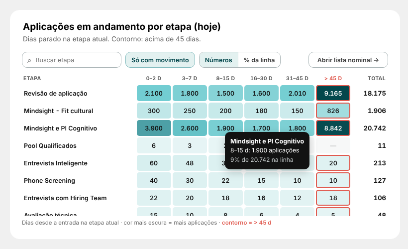

# 10 · Aplicações em andamento por etapa (hoje) — página Report

Visual: **XP · Matriz de calor** (`dist/XP - Matriz de calor 1.2.0.pbiviz`). O mesmo visual serve depois para "Aprovados por praça em cada etapa".



## 1. Tabela das faixas (Modelagem → Nova tabela)
```DAX
dFaixaDias =
DATATABLE(
    "faixa", STRING, "ordem", INTEGER, "de", INTEGER, "ate", INTEGER,
    {
        { "0–2 d",    1,  0,     2 },
        { "3–7 d",    2,  3,     7 },
        { "8–15 d",   3,  8,    15 },
        { "16–30 d",  4, 16,    30 },
        { "31–45 d",  5, 31,    45 },
        { "> 45 d",   6, 46, 99999 }
    }
)
```
- `dFaixaDias[faixa]` → Classificar por coluna → `ordem`.
- **Sem relação** com nenhuma tabela.

## 2. Medida (pasta `98. ESTEIRAS\04. Ativos`)
```DAX
Esteira | Ativos na Faixa =
VAR De  = MIN( dFaixaDias[de] )
VAR Ate = MAX( dFaixaDias[ate] ) + 1
RETURN
CALCULATE(
    DISTINCTCOUNT( '13_ETAPA_RECRUTAMENTO'[application_id] ),
    KEEPFILTERS( '13_ETAPA_RECRUTAMENTO'[resultado_etapa] = "Em andamento" ),
    KEEPFILTERS( '13_ETAPA_RECRUTAMENTO'[days_in_stage] >= De ),
    KEEPFILTERS( '13_ETAPA_RECRUTAMENTO'[days_in_stage] <  Ate )
)
```
Mesma regra de `Esteira | Ativos Acima de 45 Dias` (a coluna "> 45 d" bate com ela).

## 3. Visual
| Campo | O que colocar |
|---|---|
| Linhas | `dEtapa[stage_name]` |
| Colunas | `dFaixaDias[faixa]` |
| Valor | `Esteira \| Ativos na Faixa` |

Posição: **X 316 · Y 1574 · L 736 · A 360**. Formatar → Geral: desligar Título e Plano de fundo.

Botão "Abrir lista nominal →" (botão nativo: Inserir → Botões → Em branco): **X 892 · Y 1574 · L 160 · A 32**, texto 12, borda #A9B4B6 arredondada 10, Ação → Navegação de página → Nominal.

## Como funciona
- Cor mais escura = mais aplicações (degradê claro → meio → escuro, sem legenda). Última coluna com contorno coral (Formatar → Coluna de alerta).
- Busca, "Só com movimento", Números | % da linha, clique no título da coluna para ordenar (ex.: "> 45 d" mostra as etapas com mais aplicações paradas).
- Dica com o valor e o % da linha. Clique na célula filtra a página por etapa + faixa; clique no nome filtra a etapa.
