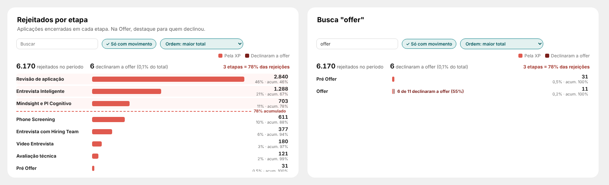

# 11 · Rejeitados por etapa (página Report)

Visual: **XP · Barras com composição 1.1.0** (`dist/XP - Barras com composicao 1.1.0.pbiviz`). Importar por cima da 1.0.0: o Resumo continua igual (as opções novas vêm desligadas), só os números passam a sair no padrão brasileiro (6.170 e 71,1%).

## Posição
| X | Y | Largura | Altura |
|---|---|---|---|
| 1120 | 1574 | 736 | 360 |

## Campos
| Campo | O que colocar |
|---|---|
| Linhas | `dEtapa[stage_name]` |
| Partes da barra | 1) `Esteira \| Rejeitados (Empresa)` 2) `Esteira \| Declinados (Offer)` |
| Total, Indicador, Destaque | vazios |

## Formatar
| Grupo | Opção | Valor |
|---|---|---|
| Barras | Altura da barra / Espaço entre linhas | 14 / 4 |
| Barras | Cor da parte 1 / Cor da parte 2 | `#E05A4F` / `#7A1F1A` |
| Barras | Mostrar valores abaixo da barra | desligado |
| Nomes | Largura dos nomes / Nome da parte 1 / Nome da parte 2 | 190 / Pela XP / Declinaram a offer |
| Ferramentas | Abrir só com movimento | ligado |
| Resumo e parte em destaque | Mostrar linha de resumo / Texto após o total | ligado / rejeitados no período |
| Resumo e parte em destaque | Parte em destaque / Texto | Parte 2 / declinaram a offer |
| Ranking (Pareto) | Mostrar % do total e acumulado / Corte / Nome dos itens / Texto do corte | ligado / 80 / etapas / das rejeições |
| Ranking (Pareto) | Ordem ao abrir | Maior total |

## Como funciona
- Ordem "maior total": % do total e acumulado em cada linha, linha tracejada no corte e "N etapas = X% das rejeições" no topo; linhas até o corte com fundo rosado. Em "ordem original", mostra só o % do total.
- Parte em destaque (declinaram) escrita ao lado da barra: "6 de 11 declinaram a offer (55%)".
- Botão direito numa etapa → Detalhar → página nominal (quando a página nominal tiver o campo de detalhamento).
