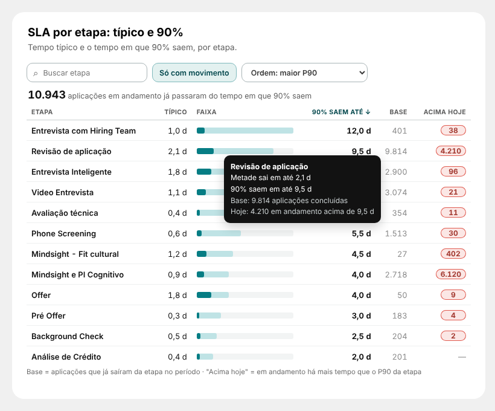

# 12 · SLA por etapa: típico e 90% (página Report)

Visual: **XP · Tabela de SLA** (`dist/XP - Tabela de SLA 1.0.0.pbiviz`).



## Medidas (pasta `98. ESTEIRAS\02. Etapa - Tempo`)
```DAX
Esteira | Dias na Etapa (P90) =
VAR Ini = MIN('_dCALENDARIO'[Data])
VAR Fim = MAX('_dCALENDARIO'[Data]) + 1
RETURN
CALCULATE(
    PERCENTILE.INC('13_ETAPA_RECRUTAMENTO'[days_in_stage], 0.9),
    KEEPFILTERS( NOT ISBLANK('13_ETAPA_RECRUTAMENTO'[stage_name]) ),
    KEEPFILTERS( NOT ISBLANK('13_ETAPA_RECRUTAMENTO'[data_saida_stage]) ),
    KEEPFILTERS( '13_ETAPA_RECRUTAMENTO'[data_entrada_stage] >= Ini ),
    KEEPFILTERS( '13_ETAPA_RECRUTAMENTO'[data_entrada_stage] <  Fim )
)

Esteira | Base SLA =
VAR Ini = MIN('_dCALENDARIO'[Data])
VAR Fim = MAX('_dCALENDARIO'[Data]) + 1
RETURN
CALCULATE(
    COUNTROWS('13_ETAPA_RECRUTAMENTO'),
    KEEPFILTERS( NOT ISBLANK('13_ETAPA_RECRUTAMENTO'[stage_name]) ),
    KEEPFILTERS( NOT ISBLANK('13_ETAPA_RECRUTAMENTO'[data_saida_stage]) ),
    KEEPFILTERS( '13_ETAPA_RECRUTAMENTO'[data_entrada_stage] >= Ini ),
    KEEPFILTERS( '13_ETAPA_RECRUTAMENTO'[data_entrada_stage] <  Fim )
)

Esteira | Acima do P90 Hoje =
SUMX(
    VALUES( dEtapa[stage_name] ),
    VAR P = [Esteira | Dias na Etapa (P90)]
    RETURN
        IF(
            NOT ISBLANK( P ),
            CALCULATE(
                DISTINCTCOUNT('13_ETAPA_RECRUTAMENTO'[application_id]),
                KEEPFILTERS( '13_ETAPA_RECRUTAMENTO'[resultado_etapa] = "Em andamento" ),
                KEEPFILTERS( '13_ETAPA_RECRUTAMENTO'[days_in_stage] > P )
            )
        )
)
```
Formato: P90 decimal com 1 casa; Base e Acima número inteiro. Mesmas regras da `Esteira | Dias na Etapa (Mediana)` (mesma base, mesmo período).

## Visual
| Campo | O que colocar |
|---|---|
| Etapa | `dEtapa[stage_name]` |
| Típico (mediana, dias) | `Esteira \| Dias na Etapa (Mediana)` |
| 90% saem até (P90, dias) | `Esteira \| Dias na Etapa (P90)` |
| Base (concluídas) | `Esteira \| Base SLA` |
| Acima hoje | `Esteira \| Acima do P90 Hoje` |

Posição: **X 316 · Y 2058 · L 736 · A 540**. Formatar → Geral: desligar Título e Plano de fundo.

## Como funciona
- Típico = metade sai até aqui; 90% saem até = só 1 em 10 demora mais (SLA realista da etapa).
- Faixa: escuro até o típico, claro até o P90 (mesma escala em todas as linhas). Dica com base e casos acima.
- "Acima hoje": em andamento há mais tempo que o P90 da etapa; total no topo.
- Busca, "Só com movimento", ordem (maior P90, processo, mais acima hoje, maior típico) ou clique no título da coluna.
- Clique filtra a página pela etapa; botão direito → Detalhar.
