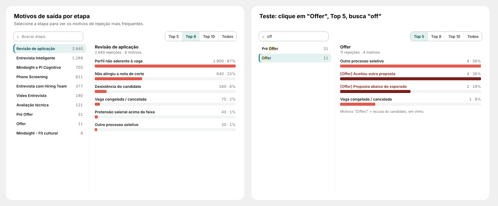

# 13 · Motivos de saída por etapa (página Report)

Visual: **XP · Etapa e motivos** (`dist/XP - Etapa e motivos 1.0.0.pbiviz`).

## Posição
| X | Y | Largura | Altura |
|---|---|---|---|
| 1120 | 2058 | 736 | 540 |

Formatar → Geral: desligar Título e Plano de fundo.

## Campos (nenhuma medida nova)
| Campo | O que colocar |
|---|---|
| Lista (esquerda) | `dEtapa[stage_name]` |
| Itens (direita) | `13_ETAPA_RECRUTAMENTO[rejection_reason_name]` |
| Valor | `Esteira \| Rejeitados` |

## Como funciona
- Lista de etapas com o total de rejeições (maior primeiro; "Ordem original" em Formatar → Comportamento). A maior já vem escolhida.
- À direita: motivos da etapa escolhida, com quantidade e % das rejeições dela; Top 5 / 8 / 10 / Todos; o resto vira "Outros (n motivos)".
- Motivos que começam com "[Offer]" (recusa do candidato) em vinho (Formatar → Destaque).
- Busca de etapa sem acento; setas ↑ ↓ trocam a etapa.
- Clique num motivo filtra a página (etapa + motivo). Escolher a etapa na lista não filtra a página (pode ligar em Comportamento).
