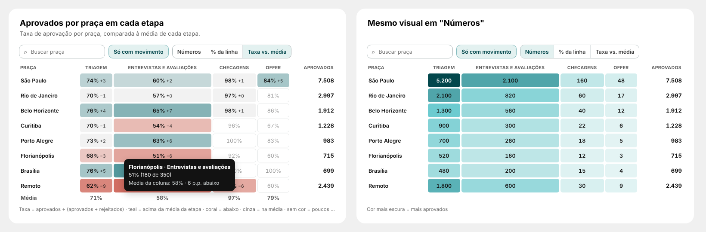
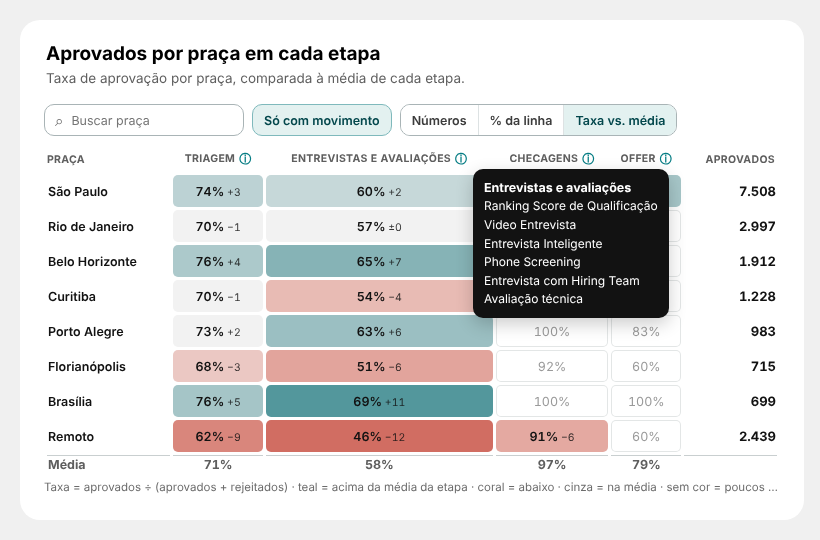

# 14 · Aprovados por praça em cada etapa (página Report)

Visual: **XP · Matriz de calor 1.2.0** (`dist/XP - Matriz de calor 1.2.0.pbiviz`). Importar por cima da versão anterior: a matriz de tempo parado continua igual (sem "Base da taxa" o botão de taxa não aparece).



## Posição
| X | Y | Largura | Altura |
|---|---|---|---|
| 316 | 2722 | 736 | 400 |

## Campos (nenhuma medida nova)
| Campo | O que colocar |
|---|---|
| Linhas | a coluna de praça (a mesma da segmentação "Praça") |
| Colunas | `dEtapa[grupo]` (já classificada por `ordem_grupo`) |
| Valor | `Esteira \| Aprovados` |
| Base da taxa | `Esteira \| Rejeitados` |
| Detalhe da coluna | `Esteira \| Etapas do Grupo` (ⓘ no título de cada grupo) |

Para usar só algumas etapas-chave no lugar dos grupos: Colunas = `dEtapa[stage_name]` e filtro do visual nas etapas desejadas.

## Medida do ⓘ (etapas de cada grupo)
```DAX
Esteira | Etapas do Grupo =
CONCATENATEX(
    VALUES( dEtapa[stage_name] ),
    dEtapa[stage_name],
    UNICHAR(10),
    CALCULATE( MIN( dEtapa[ordem] ) ), ASC
)
```


## Formatar
| Grupo | Opção | Valor |
|---|---|---|
| Textos | Título da coluna das linhas / Título da coluna de total / Unidade | Praça / Aprovados / aprovados |
| Textos | Nota no rodapé | Cor mais escura = mais aprovados |
| Coluna de alerta | Destacar a última coluna | desligado |
| Taxa (com base) | Abrir em / Cálculo da taxa | Taxa vs. média / Valor ÷ (valor + base) |
| Taxa (com base) | Na média até ± / Cor cheia a partir de / Mínimo de casos | 2 / 15 / 30 |

## Como funciona
- Taxa vs. média: taxa da praça na etapa e diferença para a média da coluna ("51% −6"); teal acima, coral abaixo, cinza na média (± 2 p.p.); células com menos de 30 aprovados + rejeitados ficam sem cor (número em cinza). Linha "Média" no fim.
- Botões Números e % da linha mostram o volume de aprovados.
- Ordenar pelo título da coluna (na taxa, ordena pela taxa); clique na célula filtra praça + etapa.
