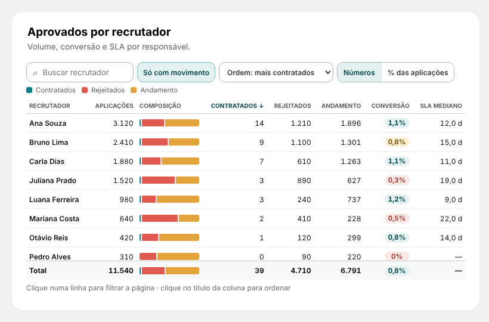

# 15 · Aprovados por recrutador (página Report)

Visual: **XP · Tabela por etapa 1.1.0** (`dist/XP - Tabela por etapa 1.1.0.pbiviz`). Importar por cima da 1.0.0: a tabela de etapas continua igual. Novidades: nomes das colunas configuráveis, colunas sem medida somem, conversão comparada à média, modo compacto automático em cards estreitos (< 1000 px).



## Medida nova
```DAX
Esteira | Aplicações Ativas =
CALCULATE( [Esteira | Candidatos], KEEPFILTERS( '13_ETAPA_RECRUTAMENTO'[status] = "active" ) )
```
Mesma base de `Esteira | Contratados` e `Esteira | Rejeitados no Processo` (pela data de candidatura): aplicações = contratados + rejeitados + ativas. Confira se o status de "em processo" no Greenhouse é mesmo `active`.

## Posição
| X | Y | Largura | Altura |
|---|---|---|---|
| 1120 | 2722 | 736 | 400 |

## Campos
| Campo | O que colocar |
|---|---|
| Etapa | a coluna de recrutador (a mesma da segmentação "Recrutador") |
| Participantes | `Esteira \| Candidatos` |
| Aprovados | `Esteira \| Contratados` |
| Rejeitados | `Esteira \| Rejeitados no Processo` |
| Em andamento | `Esteira \| Aplicações Ativas` |
| SLA média | vazio (a coluna some) |
| SLA mediana | `Esteira \| SLA da Esteira (Mediana)` |

## Formatar
| Grupo | Opção | Valor |
|---|---|---|
| Textos | Título da coluna de etapa / Texto da linha de total / Texto da busca | Recrutador / Total / Buscar recrutador |
| Textos | Coluna: participantes / aprovados / em andamento / SLA mediana | Aplicações / Contratados / Andamento / SLA mediano |
| Textos | Botão de % | % das aplicações |
| Comportamento | Somar participantes no total / Ordem ao abrir | ligado / Mais aprovados |
| Limites | Cor da conversão / Na média: atenção a partir de | Comparada à média / 70 |
| Cores | Aprovados / Rejeitados / Em andamento | `#067D84` / `#E05A4F` / `#E3A33B` (padrão) |

## Como funciona
- Conversão = contratados ÷ (contratados + rejeitados), em selo: verde ≥ média da esteira, âmbar entre 70% da média e a média, coral abaixo de 70% da média (passe o mouse no selo para ver a média).
- Busca, "Só com movimento", ordem (lista ou clique no título), "% das aplicações", total com soma das aplicações.
- Clique filtra a página pelo recrutador; botão direito → Detalhar.
