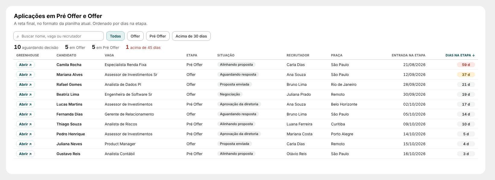
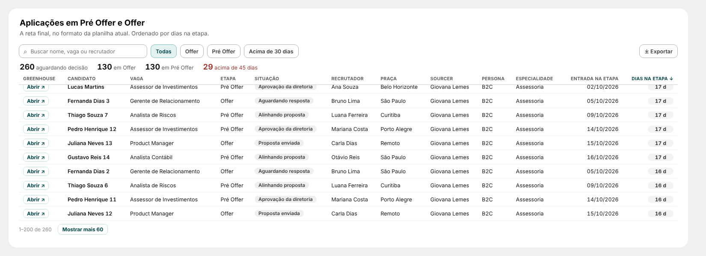

# 16 · Aplicações em Pré Offer e Offer (página Report)

Visual: **XP · Tabela nominal** (`dist/XP - Tabela nominal 1.0.0.pbiviz`). O mesmo visual serve para as tabelas da página Nominal.



## Medida nova
```DAX
Esteira | Dias na Etapa Atual =
CALCULATE(
    MAX( '13_ETAPA_RECRUTAMENTO'[days_in_stage] ),
    KEEPFILTERS( '13_ETAPA_RECRUTAMENTO'[resultado_etapa] = "Em andamento" )
)
```
Só tem valor para quem está **em andamento** na etapa: as linhas sem valor somem da lista.

## Posição
| X | Y | Largura | Altura |
|---|---|---|---|
| 316 | 3246 | 1540 | 460 |

## Campos
| Campo | O que colocar |
|---|---|
| Link | coluna com a URL do Greenhouse, ou o ID do candidato (com o modelo do link) |
| Colunas (na ordem) | nome do candidato, vaga, recrutador, praça, `13_ETAPA_RECRUTAMENTO[data_entrada_stage]` |
| Segmento (botões) | `dEtapa[stage_name]` |
| Situação (selo) | coluna de situação da proposta, se existir |
| Dias | `Esteira \| Dias na Etapa Atual` |

As duas primeiras colunas vêm antes de Etapa e Situação; as demais depois. A primeira sai em negrito.

**Filtro do visual:** `dEtapa[stage_name]` = Pré Offer e Offer.

## Formatar
- Link → Modelo do link: deixe vazio se a coluna já for a URL; com ID, use algo como `https://app.greenhouse.io/people/{valor}`.
- Textos: contador total ("aguardando decisão"), busca, botão de todos, título do link e dos dias.
- Dias: âmbar acima de 30, coral acima de 45, botão "Acima de 30 dias".
- Comportamento: máximo de linhas na tela (500) e se o segmento aparece como coluna.

## Como funciona
- Ordenado por dias (maior primeiro); clique em qualquer título para ordenar.
- Busca em todas as colunas, sem acento, com destaque. Botões Todas / cada etapa / Acima de 30 dias.
- Contadores: total, por etapa e acima de 45 dias. "Abrir ↗" abre o Greenhouse.
- Exportar: menu ⋯ do visual → Exportar dados (precisa estar liberado no workspace).

## Atualização 1.1.0 (`dist/XP - Tabela nominal 1.1.0.pbiviz`)

Importe por cima da 1.0.0: campos e formatação continuam.
- **Mostrar mais:** a lista abre com 100 linhas e o botão no rodapé traz mais 100 por vez ("1–100 de 260"). Formatar → Comportamento → Linhas por vez.
- **Mais colunas:** o campo Colunas aceita até 30 (antes 12). Para colocar em ordem, arraste dentro do campo.
- **Carrega tudo:** até 100 mil aplicações, em blocos de 10 mil (Formatar → Comportamento → Máximo de aplicações carregadas).
- **Exportar:** CSV que abre no Excel, com a busca e os botões aplicados (precisa de "downloads de visuais personalizados" liberado pelo admin; se não estiver, aparece "Use ⋯ → Exportar dados"). Pode ser desligado em Comportamento.
- Busca, botões e ordenação voltam a lista para as primeiras 100 linhas.
