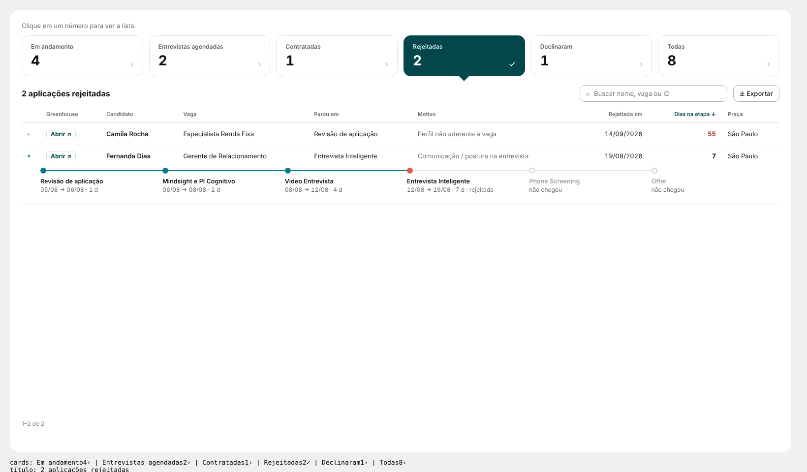

# 17 · Página Nominal: big numbers + lista + linha do tempo

Visual: **XP · Base nominal** (`dist/XP - Base nominal 1.1.0.pbiviz`). Fundo: `BG - Esteiras_Nominal.svg` (um card único abaixo dos filtros).



Uma linha = uma aplicação (candidatura no período). Os números dos cards são contados pelo próprio visual a partir das linhas: o número é sempre o tamanho da lista.

## Posição
| X | Y | Largura | Altura |
|---|---|---|---|
| 316 | 386 | 1540 | 1246 |

Formatar → Geral: desligar Título e Plano de fundo. Filtros do topo: os mesmos das outras páginas (sincronizados).

## 1. Tabela auxiliar (Modelagem → Nova tabela)
```DAX
dEsteiraEtapa =
SUMMARIZE( '13_ETAPA_RECRUTAMENTO', '13_ETAPA_RECRUTAMENTO'[esteira], dEtapa[stage_name], dEtapa[ordem] )
```
Sem relação com nada. Serve para saber quais etapas cada esteira tem (as "não chegou" da linha do tempo).

## 2. Medidas (pasta `98. ESTEIRAS\07. Nominal`)
```DAX
Esteira | Nominal Situação =
VAR Cand = [Esteira | Candidatos]
VAR St   = MAX( '13_ETAPA_RECRUTAMENTO'[status] )
VAR Dec  = CALCULATE( COUNTROWS( '13_ETAPA_RECRUTAMENTO' ), KEEPFILTERS( LEFT( '13_ETAPA_RECRUTAMENTO'[rejection_reason_name], 7 ) = "[Offer]" ) )
RETURN
IF( ISBLANK( Cand ), BLANK(),
    SWITCH( TRUE(),
        St = "hired", "Contratada",
        St = "rejected" && Dec > 0, "Declinou",
        St = "rejected", "Rejeitada",
        St = "active", "Em andamento",
        "Outro" ) )

Esteira | Nominal Etapa Atual =
IF( ISBLANK( [Esteira | Nominal Situação] ), BLANK(),
    MAXX( TOPN( 1, '13_ETAPA_RECRUTAMENTO', '13_ETAPA_RECRUTAMENTO'[data_entrada_stage], DESC ), '13_ETAPA_RECRUTAMENTO'[stage_name] ) )

Esteira | Nominal Dias na Etapa =
IF( ISBLANK( [Esteira | Nominal Situação] ), BLANK(),
    MAXX( TOPN( 1, '13_ETAPA_RECRUTAMENTO', '13_ETAPA_RECRUTAMENTO'[data_entrada_stage], DESC ), '13_ETAPA_RECRUTAMENTO'[days_in_stage] ) )

Esteira | Nominal Motivo =
IF( ISBLANK( [Esteira | Nominal Situação] ), BLANK(),
    MAXX(
        TOPN( 1, FILTER( '13_ETAPA_RECRUTAMENTO', NOT ISBLANK( '13_ETAPA_RECRUTAMENTO'[rejection_reason_name] ) ),
              '13_ETAPA_RECRUTAMENTO'[data_entrada_stage], DESC ),
        '13_ETAPA_RECRUTAMENTO'[rejection_reason_name] ) )

Esteira | Nominal Candidatura =
IF( ISBLANK( [Esteira | Nominal Situação] ), BLANK(), MIN( '13_ETAPA_RECRUTAMENTO'[data_aplicacao] ) )

Esteira | Nominal Data de Saída =
VAR Sit = [Esteira | Nominal Situação]
RETURN
SWITCH( Sit,
    "Contratada", MAX( '13_ETAPA_RECRUTAMENTO'[data_contratacao] ),
    "Rejeitada",  MAX( '13_ETAPA_RECRUTAMENTO'[rejected_at] ),
    "Declinou",   MAX( '13_ETAPA_RECRUTAMENTO'[rejected_at] ) )

Esteira | Nominal SLA =
IF( [Esteira | Nominal Situação] = "Contratada", MAX( '13_ETAPA_RECRUTAMENTO'[sla_esteira_dias] ) )

Esteira | Nominal Próxima Entrevista =
IF( [Esteira | Nominal Situação] = "Em andamento",
    CALCULATE(
        MIN( '14_WD_GREENHOUSE_SCHEDULED_INTERVIEWS'[start_at] ),
        KEEPFILTERS( '14_WD_GREENHOUSE_SCHEDULED_INTERVIEWS'[start_at] >= NOW() ),
        KEEPFILTERS( '14_WD_GREENHOUSE_SCHEDULED_INTERVIEWS'[status] <> "to_be_scheduled" ),
        TREATAS( VALUES( '13_ETAPA_RECRUTAMENTO'[application_id] ), '14_WD_GREENHOUSE_SCHEDULED_INTERVIEWS'[application_id] )
    ) )

Esteira | Nominal Etapa da Entrevista =
VAR Prox = [Esteira | Nominal Próxima Entrevista]
RETURN
IF( NOT ISBLANK( Prox ),
    CALCULATE(
        MAX( '14_WD_GREENHOUSE_SCHEDULED_INTERVIEWS'[etapa_entrevista] ),
        KEEPFILTERS( '14_WD_GREENHOUSE_SCHEDULED_INTERVIEWS'[start_at] = Prox ),
        TREATAS( VALUES( '13_ETAPA_RECRUTAMENTO'[application_id] ), '14_WD_GREENHOUSE_SCHEDULED_INTERVIEWS'[application_id] )
    ) )

-- Linha do tempo: etapa|entrada|saída|resultado|dias;;… (em ordem de entrada)
Esteira | Nominal Jornada =
IF( ISBLANK( [Esteira | Nominal Situação] ), BLANK(),
    CONCATENATEX(
        SUMMARIZE( '13_ETAPA_RECRUTAMENTO',
            '13_ETAPA_RECRUTAMENTO'[stage_name], '13_ETAPA_RECRUTAMENTO'[data_entrada_stage],
            '13_ETAPA_RECRUTAMENTO'[data_saida_stage], '13_ETAPA_RECRUTAMENTO'[resultado_etapa],
            '13_ETAPA_RECRUTAMENTO'[days_in_stage] ),
        '13_ETAPA_RECRUTAMENTO'[stage_name]
            & "|" & FORMAT( '13_ETAPA_RECRUTAMENTO'[data_entrada_stage], "yyyy-mm-dd" )
            & "|" & IF( ISBLANK( '13_ETAPA_RECRUTAMENTO'[data_saida_stage] ), "", FORMAT( '13_ETAPA_RECRUTAMENTO'[data_saida_stage], "yyyy-mm-dd" ) )
            & "|" & '13_ETAPA_RECRUTAMENTO'[resultado_etapa]
            & "|" & FORMAT( '13_ETAPA_RECRUTAMENTO'[days_in_stage], "0" ),
        ";;",
        '13_ETAPA_RECRUTAMENTO'[data_entrada_stage], ASC ) )

-- Etapas da esteira que vêm depois da última por onde a aplicação passou
Esteira | Nominal Etapas Seguintes =
VAR Sit = [Esteira | Nominal Situação]
VAR Est = MAX( '13_ETAPA_RECRUTAMENTO'[esteira] )
VAR Ult = MAXX( '13_ETAPA_RECRUTAMENTO', RELATED( dEtapa[ordem] ) )
RETURN
IF( Sit IN { "Em andamento", "Rejeitada", "Declinou" },
    CONCATENATEX(
        FILTER( dEsteiraEtapa, dEsteiraEtapa[esteira] = Est && dEsteiraEtapa[ordem] > Ult ),
        dEsteiraEtapa[stage_name], ";;", dEsteiraEtapa[ordem], ASC ) )
```

## 3. Campos do visual
| Campo | O que colocar |
|---|---|
| Link (1ª coluna) | coluna com a URL do Greenhouse, ou o ID (com o modelo do link) |
| Candidato | nome do candidato |
| Vaga | nome da vaga |
| Recrutador | a coluna de recrutador |
| Colunas extras | até 4 (ex.: praça, sourcer, e-mail) |
| Situação | `Esteira \| Nominal Situação` |
| Etapa atual / onde parou | `Esteira \| Nominal Etapa Atual` |
| Dias na etapa | `Esteira \| Nominal Dias na Etapa` |
| Motivo | `Esteira \| Nominal Motivo` |
| Data da candidatura | `Esteira \| Nominal Candidatura` |
| Data de saída | `Esteira \| Nominal Data de Saída` |
| SLA (dias) | `Esteira \| Nominal SLA` |
| Próxima entrevista | `Esteira \| Nominal Próxima Entrevista` |
| Etapa da entrevista | `Esteira \| Nominal Etapa da Entrevista` |
| Jornada | `Esteira \| Nominal Jornada` |
| Etapas seguintes | `Esteira \| Nominal Etapas Seguintes` |

Formatar → Link → Modelo: vazio se a coluna já for a URL; com ID, algo como `https://app.greenhouse.io/people/{valor}`.

## Colunas de cada base (o link vem sempre primeiro; as extras no fim)
| Base | Colunas | Ordem ao abrir |
|---|---|---|
| Em andamento | candidato, vaga, recrutador, etapa atual, dias parado | dias parado ↓ |
| Entrevistas agendadas | candidato, vaga, recrutador, etapa, entrevista em (data e hora) | mais próxima ↑ |
| Contratadas | candidato, vaga, recrutador, contratada em, SLA | mais recente ↓ |
| Rejeitadas | candidato, vaga, parou em, motivo, rejeitada em, dias na etapa | dias ↓ |
| Declinaram | candidato, vaga, recrutador, motivo, recusou em | mais recente ↓ |
| Todas | candidato, vaga, situação, etapa atual, candidatura | mais recente ↓ |

## Como funciona
- Clique num card: a lista troca, o card fica escuro com ✓ e uma seta para a tabela; o título repete a base com o número.
- ▸ (ou clique na linha) abre a linha do tempo: etapas com datas, dias e resultado (teal aprovada, coral rejeitada, âmbar em andamento) e as próximas em cinza ("não chegou").
- Busca em todas as colunas, ordenação pelo título, "Mostrar mais" de 100 em 100.
- Exportar: CSV que abre no Excel (precisa de "downloads de visuais personalizados" liberado pelo admin do Power BI; se não estiver, use ⋯ → Exportar dados).
- Carrega até 100 mil aplicações em blocos de 10 mil (Formatar → Comportamento).

## Atualização 1.1.0: os cards seguem as regras do Resumo
| Card | Regra (igual ao Resumo) |
|---|---|
| Em andamento | em processo **hoje** (`Esteira \| Ativos Agora`), independente da data de candidatura |
| Entrevistas agendadas | entrevista com data **dentro do período** (mesmos filtros de `Esteira \| Entrevistas Agendadas`) |
| Contratadas / Rejeitadas / Declinaram | candidatura no período (como `Esteira \| Contratados` e "decididos") |
| Todas | candidatura no período (= card Aplicações) |

Medidas novas ou trocadas (substituem as de mesmo nome acima):
```DAX
Esteira | Nominal No Período =
IF( NOT ISBLANK( [Esteira | Candidatos] ), 1 )

Esteira | Nominal Situação =
VAR NoPer = NOT ISBLANK( [Esteira | Candidatos] )
VAR Ativo = NOT ISBLANK( [Esteira | Ativos Agora] )
VAR St    = LOWER( MAX( '13_ETAPA_RECRUTAMENTO'[status] ) )
VAR Dec   = CALCULATE( COUNTROWS( '13_ETAPA_RECRUTAMENTO' ), KEEPFILTERS( LEFT( '13_ETAPA_RECRUTAMENTO'[rejection_reason_name], 7 ) = "[Offer]" ) )
RETURN
SWITCH( TRUE(),
    Ativo, "Em andamento",
    NOT NoPer, BLANK(),
    St = "hired", "Contratada",
    St = "rejected" && Dec > 0, "Declinou",
    St = "rejected", "Rejeitada",
    "Outro" )

Esteira | Nominal Entrevista no Período =
VAR Ini = MIN( '_dCALENDARIO'[Data] )
VAR Fim = MAX( '_dCALENDARIO'[Data] ) + 1
RETURN
CALCULATE(
    MIN( '14_WD_GREENHOUSE_SCHEDULED_INTERVIEWS'[start_at] ),
    KEEPFILTERS( '14_WD_GREENHOUSE_SCHEDULED_INTERVIEWS'[status] <> "to_be_scheduled" ),
    KEEPFILTERS( '14_WD_GREENHOUSE_SCHEDULED_INTERVIEWS'[start_at] >= Ini ),
    KEEPFILTERS( '14_WD_GREENHOUSE_SCHEDULED_INTERVIEWS'[start_at] <  Fim ),
    TREATAS( VALUES( '13_ETAPA_RECRUTAMENTO'[application_id] ), '14_WD_GREENHOUSE_SCHEDULED_INTERVIEWS'[application_id] ),
    TREATAS( VALUES( '13_ETAPA_RECRUTAMENTO'[stage_name] ),     '14_WD_GREENHOUSE_SCHEDULED_INTERVIEWS'[etapa_entrevista] )
)

Esteira | Nominal Na Base =
IF( NOT ISBLANK( [Esteira | Nominal Situação] ) || NOT ISBLANK( [Esteira | Nominal Entrevista no Período] ), 1 )
```
- Em **Etapa da Entrevista**, troque `[Esteira | Nominal Próxima Entrevista]` por `[Esteira | Nominal Entrevista no Período]`. A medida "Próxima Entrevista" pode ser apagada.
- Nas medidas **Etapa Atual, Dias na Etapa, Motivo, Candidatura e Jornada**, troque `ISBLANK( [Esteira | Nominal Situação] )` por `ISBLANK( [Esteira | Nominal Na Base] )`.
- No visual: campo **Próxima entrevista** ← `Esteira | Nominal Entrevista no Período`; campo novo **No período** ← `Esteira | Nominal No Período`.
