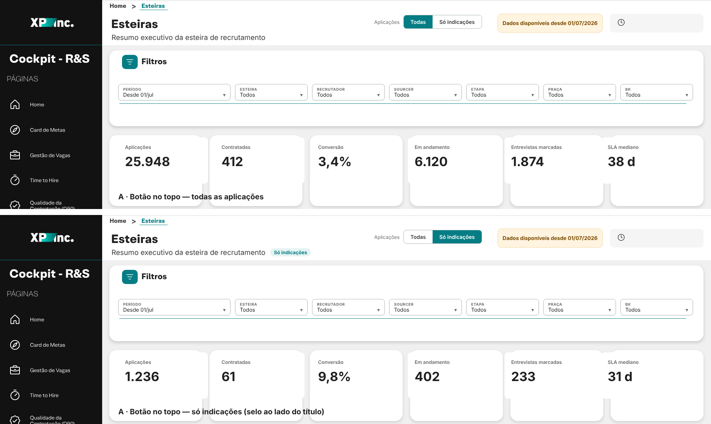

# 19 · Botão "Todas | Só indicações"

Um botão no topo de cada página que troca o dash inteiro entre todas as aplicações e só as indicações. Quando "Só indicações" está ligado, aparece um selo ao lado do título.



Tempo: ~20 minutos. Nada de Power Query, nem .pbiviz novo, nem medida alterada.

---

## Antes de começar: as colunas de indicação
Você já criou as duas colunas (passo feito). Confira se estão assim:

| Tabela | Coluna | Valores |
|---|---|---|
| `03_APPLICATIONS_GH` | `indicacao` | Pela aplicação · Pelo candidato · Sem indicação |
| `13_ETAPA_RECRUTAMENTO` | `indicacao` | Indicação · Sem indicação |

---

## Passo 1 · Tabela do botão
1. Guia **Modelagem** → **Nova tabela**.
2. Cole e confirme com Enter:
```DAX
dFiltroIndicacao =
DATATABLE(
    "opcao", STRING, "ordem", INTEGER, "indicacao", STRING,
    {
        { "Todas",         1, "Indicação" },
        { "Todas",         1, "Sem indicação" },
        { "Só indicações", 2, "Indicação" }
    }
)
```
3. No painel **Dados**, clique em `dFiltroIndicacao[opcao]` → guia **Ferramentas de coluna** → **Classificar por coluna** → `ordem`. Sem isso, "Só indicações" aparece antes de "Todas".
4. Clique com o botão direito em `ordem` e em `indicacao` → **Ocultar na exibição de relatório**. Só `opcao` fica visível.

**Por que três linhas:** "Todas" aponta para as duas categorias, e "Só indicações" aponta só para "Indicação". O botão escolhe a opção, e a tabela diz quais categorias passam.

## Passo 2 · Relação
1. Vá para a **Exibição de modelo** (ícone da esquerda, o terceiro).
2. Arraste `dFiltroIndicacao[indicacao]` até `13_ETAPA_RECRUTAMENTO[indicacao]`.
3. Na janela da relação, ajuste:
   - **Cardinalidade:** Muitos para muitos (*:*). O aviso amarelo é normal: confirme.
   - **Direção do filtro cruzado:** Única, com **dFiltroIndicacao filtra 13_ETAPA_RECRUTAMENTO**.
   - **Tornar esta relação ativa:** ligado.
4. **OK**.

Teste rápido: numa página de rascunho, coloque uma tabela com `dFiltroIndicacao[opcao]` e `Esteira | Candidatos`.
- "Todas" tem que mostrar o mesmo número do card de Aplicações.
- "Só indicações", um número menor.

## Passo 3 · O botão
Use a **Segmentação de botão** (visual nativo novo). Se ela não aparecer no seu Power BI, veja a alternativa no fim deste passo.

1. Na página **Resumo**, clique num espaço vazio da tela.
2. Painel **Visualizações** → **Segmentação de botão** (*Button slicer*).
3. Campo: arraste `dFiltroIndicacao[opcao]`.
4. **Formatar visual → Geral → Propriedades → Tamanho e posição**:
   - X **1000** · Y **40** · Largura **290** · Altura **40**
5. **Formatar visual → Visual**:

| Grupo | Opção | Valor |
|---|---|---|
| Layout | Linhas / Colunas | 1 / 2 |
| Layout | Espaçamento entre botões | 0 |
| Seleção | Seleção única | **ligado** |
| Seleção | Forçar seleção (*Force selection*) | **ligado**: sempre há um marcado |
| Seleção | "Selecionar tudo" | desligado |
| Botão → Estado **Padrão** | Preenchimento | `#FFFFFF` |
| Botão → Estado **Ao passar o mouse** | Preenchimento | `#E6F3F3` |
| Botão → Estado **Selecionado** | Preenchimento | `#067D84` |
| Borda (todos os estados) | Cor / Largura / Raio dos cantos | `#A9B4B6` / 1 / 8 |
| Valor do texto explicativo (*Callout value*) → **Padrão** | Fonte / Tamanho / Cor | Segoe UI Semibold / 10,5 / `#3A3A3A` |
| Valor do texto explicativo → **Selecionado** | Cor | `#FFFFFF` |
| Rótulo / Imagem | | desligados |

6. **Formatar visual → Geral**: desligue **Título**, **Plano de fundo** e **Sombra**.
7. Clique em **Todas** para deixar esse botão marcado.

**Alternativa (segmentação clássica):** se a "Segmentação de botão" não aparecer, use a **Segmentação** normal com o mesmo campo, ajustando:
- **Configurações da segmentação → Estilo:** Bloco;
- **Seleção:** Seleção única ligada, "Mostrar Selecionar tudo" desligado.

A cor do botão selecionado na clássica é fixa (cinza-escuro), mas funciona igual.

## Passo 4 · Rótulo "Aplicações"
1. Guia **Inserir** → **Caixa de texto** → digite `Aplicações`.
2. Fonte Segoe UI, tamanho 10, cor `#6B6B6B`.
3. Desligue o plano de fundo da caixa.
4. Posição: X **920** · Y **48** · Largura **76** · Altura **24**.

## Passo 5 · Selo "Só indicações" ao lado do título
1. Crie duas medidas (pasta `98. ESTEIRAS\07. Textos`):
```DAX
Esteira | Selo Indicação =
IF( SELECTEDVALUE( dFiltroIndicacao[opcao] ) = "Só indicações", "Só indicações", " " )

Esteira | Cor Selo Indicação =
IF( SELECTEDVALUE( dFiltroIndicacao[opcao] ) = "Só indicações", "#E6F3F3", "#FFFFFF" )
```
2. Insira um **Cartão** (o clássico) com `Esteira | Selo Indicação`.
3. Formatar:

| Onde | Opção | Valor |
|---|---|---|
| Visual → Valor do balão | Fonte / Tamanho / Cor | Segoe UI Bold / 10 / `#067D84` |
| Visual → Rótulo da categoria | | desligado |
| Geral → Título | | desligado |
| Geral → Efeitos → Plano de fundo | Cor → botão **fx** → Formatar por: **Valor do campo** → `Esteira \| Cor Selo Indicação` | |
| Geral → Efeitos → Borda visual | Cantos arredondados | 12 (sem cor de borda) |
| Geral → Propriedades | X / Y / Largura / Altura | **722** / **86** / **140** / **26** |

Com "Todas", o selo fica branco sobre o cabeçalho branco, ou seja, invisível. Com "Só indicações", aparece a pílula verde-clara.

## Passo 6 · Levar para as outras páginas
1. Selecione os três itens (botão, caixa "Aplicações" e selo) com Ctrl + clique e copie com **Ctrl+C**.
2. Vá para **Report** e cole com **Ctrl+V**. Quando o Power BI perguntar sobre sincronizar, escolha **Sincronizar**.
3. Repita na **Nominal**, e na **Conceitos** se quiser.
4. Em cada página, ajuste só o **X do selo** para ficar logo depois do subtítulo:

| Página | X do selo (aprox.) |
|---|---|
| Resumo | 722 |
| Report | 860 |
| Nominal | 790 |

5. Confira em **Exibição → Sincronizar segmentações**: a linha `opcao` deve ter **Sincronizar** e **Visível** marcados em todas as páginas.

## Passo 7 · Deixar "Todas" como padrão e salvar
1. Em qualquer página, clique em **Todas**.
2. Salve o arquivo. O dash sempre abre do jeito que foi salvo.
3. No serviço (depois de publicar), se alguém mexer e quiser voltar: botão **Redefinir para o padrão** na barra do relatório.

## Passo 8 · Conferir
| Teste | Esperado |
|---|---|
| "Todas" | todos os cards iguais a antes do botão |
| "Só indicações" no Resumo | card Aplicações = linha "Indicação" da conferência abaixo |
| "Só indicações" e mudar de página | o botão continua marcado e o selo aparece |
| Nominal com "Só indicações" | a lista só traz indicações (confira 2 ou 3 no Greenhouse) |

```DAX
EVALUATE
SUMMARIZECOLUMNS(
    '13_ETAPA_RECRUTAMENTO'[indicacao],
    "aplicações", [Esteira | Candidatos]
)
```

## Se algo não funcionar
| Sintoma | Causa provável | O que fazer |
|---|---|---|
| Clicar no botão não muda nada | relação inativa ou direção errada | Exibição de modelo → duplo clique na relação → ativa, dFiltroIndicacao filtra 13 |
| "Todas" mostra menos aplicações que antes | alguma linha da 13 com `indicacao` vazia | a coluna da 13 deve devolver "Sem indicação" quando não acha a aplicação (o `IF` da fórmula já faz isso; confira se não ficou em branco) |
| Ordem dos botões invertida | falta classificar | Passo 1, item 3 |
| Agenda não muda com o botão | medidas de entrevista ainda antigas | as medidas novas do guia 18 já respeitam o botão (montam a lista de aplicações a partir da 13) |
| Selo aparece em branco com contorno | borda visual com cor | Geral → Efeitos → Borda visual: desligue a cor, deixe só os cantos |
