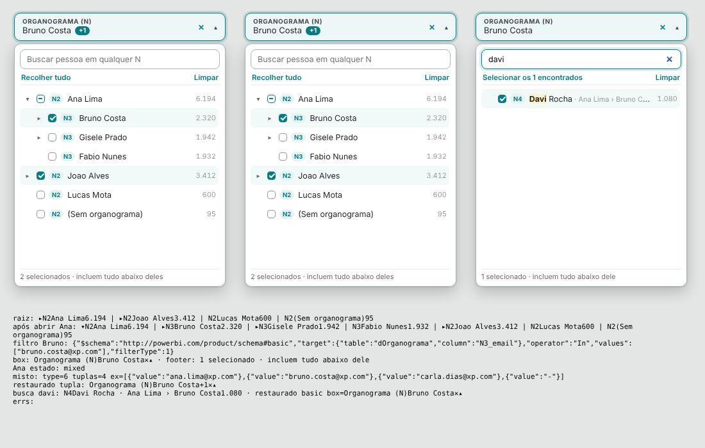

# 22 · Organograma (N), Persona, Especialidade e Período 2.2



## 1. Período 2.2 (`dist/XP - Periodo 2.2.0.pbiviz`)
Importe por cima da 2.1 (o visual na página é atualizado). O calendário continua igual; mudam os atalhos:
- "Trimestre" virou **Trimestre atual** (início do trimestre até hoje).
- Novo **Trimestre anterior** (trimestre fechado; hoje: 01/07 a 30/09).
- Quando o intervalo é um trimestre, a caixa mostra **"T3 2026 · 01/07 – 30/09"** ou **"T4 2026 · 01/10 – hoje"**.
- O destaque fica no botão clicado (em outubro, Mês atual e Trimestre atual dão o mesmo intervalo).
- Formatar → Atalhos: liga/desliga cada um.

## 2. Organograma (`dist/XP - Organograma 1.0.0.pbiviz`)

### 2.1 Tabela do organograma (Modelagem → Nova tabela)
Uma linha por vaga, com os N da cadeira da vaga (via a relação que já existe 02_JOBS_GH → 12_GE).
```DAX
dOrganograma =
SELECTCOLUMNS(
    '02_JOBS_GH',
    "job_id",   '02_JOBS_GH'[job_id],
    "N2_email", COALESCE( RELATED( '12_GE'[N2_email] ), "-" ),
    "N3_email", COALESCE( RELATED( '12_GE'[N3_email] ), "-" ),
    "N4_email", COALESCE( RELATED( '12_GE'[N4_email] ), "-" ),
    "N5_email", COALESCE( RELATED( '12_GE'[N5_email] ), "-" ),
    "N6_email", COALESCE( RELATED( '12_GE'[N6_email] ), "-" ),
    "N7_email", COALESCE( RELATED( '12_GE'[N7_email] ), "-" )
)
```
- Ajuste a lista ao número de N que a 12_GE tem (apague ou acrescente linhas).
- O `"-"` no lugar do vazio é obrigatório: é ele que diz ao visual "a estrutura termina aqui" e permite o filtro por caminho.

### 2.2 Relação
`dOrganograma[job_id]` (1) → `13_ETAPA_RECRUTAMENTO[job_id]` (muitos), direção **única**.
**Não** ative a relação inativa 13 → 03 (o período passaria a filtrar a 13 pela data de fechamento da vaga).

### 2.3 Conferir
```DAX
EVALUATE
SUMMARIZECOLUMNS( dOrganograma[N2_email], "aplicações", [Esteira | Candidatos] )
```
A soma das linhas = total de aplicações. A linha "-" = aplicações de vagas sem cadeira na 12_GE: aparecem no visual como **(Sem organograma)**.

### 2.4 Campos do visual
| Campo | O que colocar |
|---|---|
| Níveis (em ordem) | `dOrganograma[N2_email]`, `[N3_email]`, `[N4_email]`… |
| Contagem | `Esteira \| Candidatos` |

Formatar → Cabeçalho: Título `Organograma (N)`, Texto sem seleção `Todos`. Comportamento: primeiro nível `2`, "Mostrar nome a partir do e-mail" ligado (maria.silva@… → Maria Silva; o e-mail aparece ao passar o mouse), ordem por maior contagem.

### 2.5 Como funciona
- Abre nos N2; ▸ abre os N3 de cada um, e assim por diante. Quem não tem nível abaixo não abre.
- Marcar um nome inclui toda a estrutura abaixo. Pai com parte marcada fica com "–".
- Busca sem acento em qualquer N (nome ou e-mail), com o caminho do resultado.
- Filtro leve: nomes do mesmo nível viram um filtro simples na coluna daquele N; níveis misturados viram um filtro por caminho.

## 3. Persona e Especialidade
XP · Segmentação, com `13_ETAPA_RECRUTAMENTO[persona]` / `[especialidade]`, Contagem `Esteira | Candidatos`, texto sem seleção "Todas". Sincronize nas páginas.

## 4. Barra com 10 filtros (uma linha, larguras diferentes)
Todos com Y 225. Altura 320 (Organograma: 440, a árvore precisa de mais espaço).

| Filtro | X | Largura |
|---|---|---|
| Período | 316 | 200 |
| Organograma (N) | 526 | 270 |
| Esteira | 806 | 118 |
| BK | 934 | 118 |
| Recrutador | 1062 | 128 |
| Sourcer | 1200 | 118 |
| Persona | 1328 | 118 |
| Especialidade | 1456 | 140 |
| Etapa | 1606 | 118 |
| Praça | 1734 | 118 |
